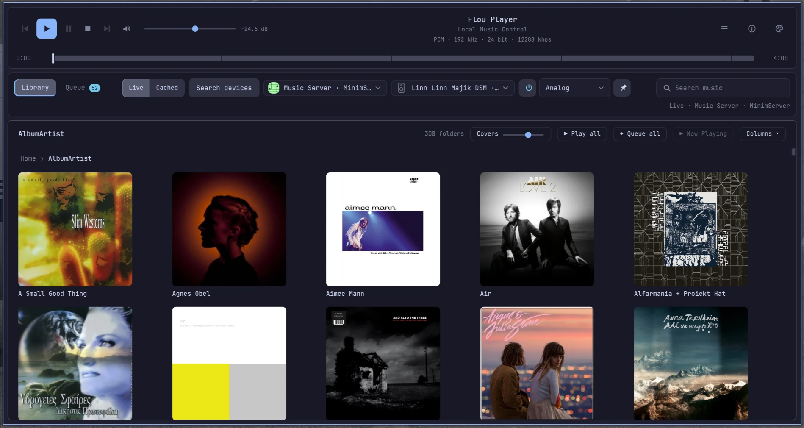
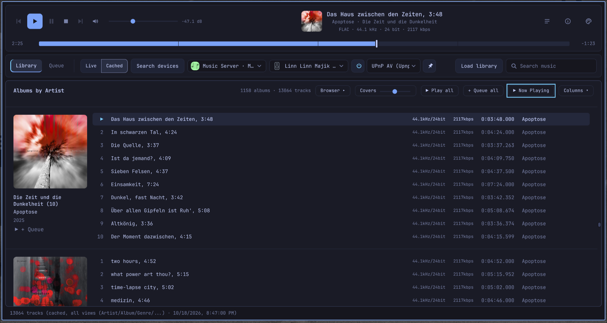

# Flou Player

**An alternative to the Linn app for Linn DSM / Majik / Klimax / Akurate streamers.**
A local, standalone, iTunes-style desktop app for browsing and playing music
from MinimServer (or any UPnP/DLNA media server) through a Linn/OpenHome
output device such as a Majik DSM4. It runs as its own application window --
no browser tab needed.

## Why Flou Player?

Linn builds excellent streamers, but I was never happy with Linn's own app --
it isn't a good way to browse and play a large local music collection. Flou
Player exists because I wanted a proper control point that simply lets me find
my music and play it on my Linn. If you have the same frustrations with the Linn app (also known
from its predecessors Kazoo and Kinsky) and use a Linn DSM/DSMs, Majik,
Akurate, Klimax or Selekt streamer with MinimServer, Flou Player is for you.
It is free, open source and runs on Linux.

*Flou Player is an independent project. It is not affiliated with, endorsed
by or supported by Linn Products Ltd. "Linn" and the names of its products
are trademarks of their respective owner and are used here only to describe
compatibility.*



*Live mode -- browsing the media server folder by folder.*



*Cached mode -- the whole library with the column browser.*

Flou Player runs on Linux (tested target: Linux Mint; also works on Arch
Linux).

## Highlights

- **Live browsing** of the media server folder by folder, like the Linn app --
  or a **cached** full-library scan with an iTunes-style column browser
  (Album Artist / Artist / Album / Year) and instant search
- Playback on **Linn/OpenHome** devices (and other UPnP renderers) with a
  position bar, volume readout (step and dB) and the device's own queue, or on the
  **local speakers** (AAC/ALAC are converted to FLAC on the fly)
- Device controls for Linn/OpenHome: mute, source selection, pins and the
  stream quality the device reports
- Keyboard control (Space, arrows, volume, mute)
- Album covers, selectable track columns, 17 colour themes, Diagnostics and
  About dialogs

## Quick start

```
./packaging/install.sh     # builds and adds "Flou Player" to the application menu
```

or, from source: `./run.command`. Computer, media server and output device
must be on the same local network. Then click **Search devices**, pick a
media server and an output device, and double-click a track.

## Documentation

- [Getting started](docs/getting-started.md) -- requirements, installing,
  running from source, Arch Linux, first start
- [User guide](docs/user-guide.md) -- live and cached library, playback, the
  queue, local playback, themes, keyboard shortcuts
- [Troubleshooting](docs/troubleshooting.md)
- [How it works](docs/how-it-works.md) -- architecture, stored files, known
  limitations
- [Development and tests](docs/development.md)
- [Versioning and releases](docs/releasing.md) and the [changelog](CHANGELOG.md)

## License

Flou Player is free software, licensed under the GNU General Public License,
version 3 or (at your option) any later version (GPL-3.0-or-later). See
[LICENSE](LICENSE). This matches the GPL v3 licensing of PyQt5, which the
desktop window uses.

## Open-source dependencies

- FastAPI, MIT
- Uvicorn, BSD-3-Clause
- upnpclient, MIT
- pywebview, BSD-3-Clause
- PyAV (`av`), BSD-3-Clause -- bundles ffmpeg libraries (LGPL)
- PyQt5 / PyQtWebEngine, GPL v3 (or commercial license from Riverbank Computing)
- QtPy, MIT

Dependencies are installed from PyPI on first local setup.
