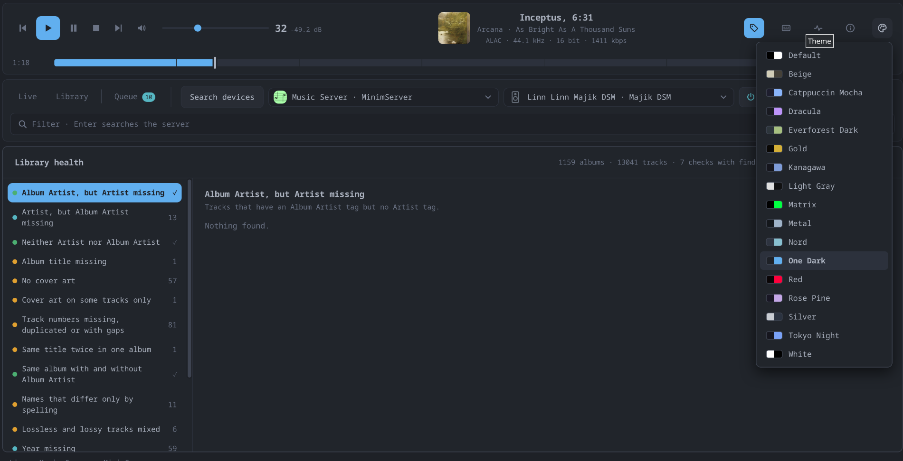
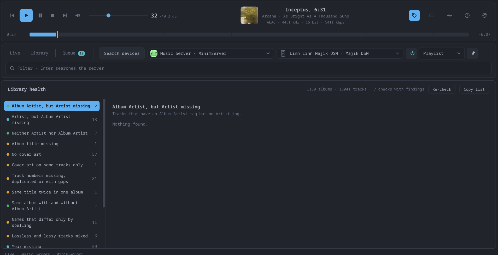
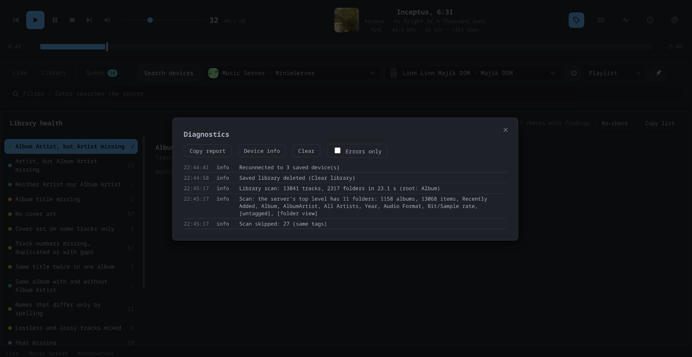

# Features

Everything Flou Player can do, at a glance. The [user guide](user-guide.md)
explains each point in detail.

## Browsing the music

*Live mode -- the server's own folders, here its album list.*

**Live mode** -- the media server as it is, folder by folder (like the Linn app)
- Whatever structure the server offers: Artists, Albums, Genres, Folders, ...
- Path bar to jump back; Backspace / Alt+← goes one folder up
- Large folders load in pages of 300 (*Load more*)
- Typing in the search field filters the open folder
- **Enter searches the whole server** (its own search, e.g. MinimServer):
  matching albums and tracks, shown as a folder of their own; **×** / Esc
  returns to where you were
- Nothing is scanned or stored: always current, starts instantly

*Library mode -- the scanned library; the playing track is marked.*

**Library mode** -- a one-time scan of the whole library, kept on disk
- iTunes-style **column browser**: Album Artist, Artist, Album, Year, with
  counts that follow the other selections, type-ahead, collapsible (Ctrl/⌘+B)
- **Instant search** across title, artist, album artist, album, genre and year
- Albums sorted by Album Artist, then title; grouped by album *and* album artist
- Duplicate tracks merged (same URL, or same title/album/duration across a
  server's views); scans stop on looping folder trees
- **Load library** (parallel scan with live count), **Cancel**, **Clear library**;
  reloaded automatically on the next start
- Notices when the music on the server has **changed since the scan** and
  offers *Reload library*

**In both modes**
- **Quality filter**: Hi-Res, CD quality, Lossless, Lossy
- Album covers with adjustable size; click for full size
- Selectable track columns: Quality (sample rate / bit depth), Bitrate, Time,
  Artist, Genre, Year
- **Now Playing** marker and button (Ctrl/⌘+L) that finds the playing track,
  even if it is filtered out or in another folder
- Right-click a track or album to inspect its raw metadata

## Playing music

- **Double-click on a Linn/OpenHome device**: the album goes into the device's
  own queue and plays from that track -- **gapless**, and it **keeps playing
  when Flou Player is closed**
- On other UPnP renderers (Marantz/Denon HEOS, Sonos, ...): the track plays,
  and the next one from the list follows automatically
- **This computer**: play through the computer's own speakers; FLAC (hi-res
  too), WAV, MP3, Ogg directly, AAC/ALAC (`.m4a`) converted to FLAC on the fly
- Transport: previous, play, pause, stop, next; **position bar** with seeking
  in blocks; elapsed / remaining time as dot-matrix (pixel LCD) digits
- **Volume**: the device's step as the Linn shows it plus the dB it works out
  to; ramped changes, mouse wheel, follows other controllers
- Display with cover, title, artist, album and the **stream quality** the
  device reports (codec, sample rate, bit depth, bit rate)

## The device queue (Queue tab, Linn/OpenHome)

- The playlist stored on the device itself, shared with other control apps
- Cover, artist, album, length and total time; Shuffle, Repeat, Clear
- Double-click to jump, × to remove
- Add with **+** (track), **+ Queue** (album), **▶** (album, replaces the
  queue), **▶ Play all** / **+ Queue all** (everything shown)

## Radio (Linn/OpenHome)

- Search internet radio stations by name or genre (radio-browser.info, no login)
- Browse the directory by country, genre or language (and combine them), with
  a Clear button to start over
- Favourites, and stream URLs of your own
- Play or queue on the output device, which fetches the stream itself (so it
  plays on with the app closed)

## TIDAL (Linn/OpenHome)

- Log in with TIDAL's device login (open a link, confirm a code)
- Search artists, albums and tracks; album and artist pages
- Play or queue on the output device, which streams TIDAL itself with its own
  TIDAL login (so it plays on with the app closed); shows whether the device
  has one

## Device controls (Linn/OpenHome)

- **Mute**, showing the device's real state
- **Source** selection (Playlist, Radio, Analog, Songcast, HDMI, ...)
- **Pins**: the favourites set up on the device, one click to play
- **Standby** on/off; picking a source or pin wakes the device
- Buttons the active source can't use (e.g. pause on live radio) are greyed
- **Firmware** version and update status in *Device info* (never installs
  anything)

## Desktop integration

- Its own application window (no browser tab), in the application menu after
  `./packaging/install.sh`; only one instance runs at a time
- **Media keys** and the panel's player controls / sound menu (MPRIS, Linux),
  also with the window in the background; the panel shows track and cover
- Remembers the chosen media server and output device and reconnects at start
- **Keyboard shortcuts** for playback, volume, seeking, navigation, with a
  built-in overview (Ctrl/⌘+/ or F1)
- **Interface zoom** (Ctrl/⌘+Plus / Minus / 0) and `FLOU_SCALE` for HiDPI screens
- **17 colour themes** (Dracula, Nord, Catppuccin, Tokyo Night, ...)

## Library health

A check of the scanned library for tag problems, each with the affected albums
and a jump to them: missing Artist / Album Artist / album title / year / genre /
cover, track numbers missing, repeated or with gaps, duplicate titles, albums
split by a partial Album Artist tag, spelling variants ("The Beatles" /
"Beatles"), lossless and lossy mixed, single-track albums, missing format
information. Lists can be copied for a spreadsheet. Nothing is changed.

## Diagnostics and About

- Log of the last 300 events (errors highlighted, badge for unseen errors,
  errors-only filter), including every library scan
- **Device info**: firmware and all services of the selected player
- **Copy report** with versions, device services and the log, for bug reports
- About: version, build, source commit, Python / system / dependency versions

## Tested on real hardware

| | |
| --- | --- |
| Tested with a **Linn Majik DSM** and **MinimServer** | browsing, Live search, playback, Pause, the device queue (gapless, plays on with the app closed), TIDAL playback, media keys / MPRIS |
| Written against the specifications, **not yet verified** | dB volume readout, mute, source, pins, standby, stream quality, firmware; playback on Marantz/Denon (HEOS) and Sonos |

Reports from other devices are welcome -- *Diagnostics → Copy report* has
everything needed.
